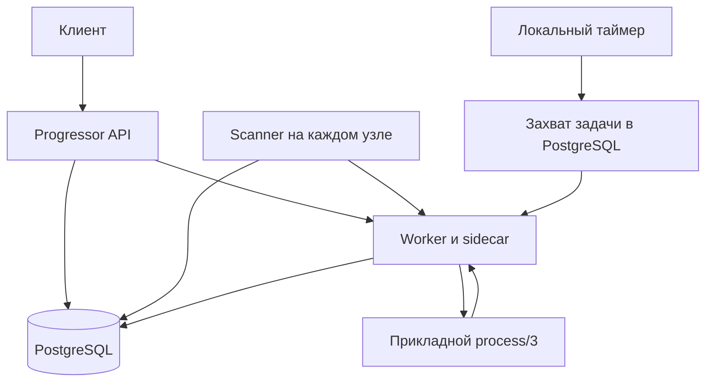

# Progressor

Progressor — библиотека Erlang/OTP для выполнения долгоживущих процессов и планирования задач поверх PostgreSQL. Приложение реализует обработчик бизнес-логики; библиотека хранит состояние, принимает команды, запускает таймеры и координирует исполнителей на нескольких узлах.

Подходит для процессов, которые переживают перезапуск приложения: отложенных операций, повторных обращений к сервисам и последовательностей шагов с сохранением результата. PostgreSQL служит общим хранилищем и координатором. Отдельный брокер сообщений не требуется.

## Модель

**Процесс** идентифицируется парой `{Namespace, ProcessId}`. Namespace задаёт обработчик, параметры выполнения и хранилище. Это логический процесс приложения, а не постоянно живущий Erlang-процесс.

**Задача** — один вызов обработчика: `init`, `call`, `timeout` или `repair`. У процесса может быть очередь внешних вызовов и один актуальный таймер, вызывающий обработчик либо удаляющий процесс.

**Поколение** — сохранённый снимок состояния. Каждый успешный шаг, кроме немедленного удаления, создаёт новое поколение, начиная с 1. Снимки сохраняются целиком; формат бинарного payload определяет приложение. Даже неизменившийся payload сохраняется в новом поколении.

Статусы процесса:

- `<<"init">>` — инициализация ещё не завершена;
- `<<"running">>` — процесс доступен для команд; это не означает, что задача сейчас выполняется;
- `<<"error">>` — для продолжения требуется восстановление.

Это реализация с поколениями состояния, а не event sourcing (https://github.com/valitydev/progressor). Схема и API истории событий с ней несовместимы; преобразования базы событий не предусмотрено.

## Подключение

Добавьте Progressor в зависимости приложения и его список OTP applications.

Пример зависимости для разработки в `rebar.config`:

```erlang
{deps, [
    {progressor, {git, "https://github.com/ttt161/progressor.git", {branch, "main"}}}
]}.
```

Нужен PostgreSQL 15 или новее: backend использует `MERGE`. Минимальный пример `sys.config` без кэша:

```erlang
[
    {epg_connector, [
        {databases, #{
            progressor_db => #{
                host => "localhost",
                port => 5432,
                database => "progressor_db",
                username => "progressor",
                password => "local-development-only"
            }
        }},
        {pools, #{
            progressor_pool => #{database => progressor_db, size => 10}
        }}
    ]},
    {progressor, [
        {defaults, #{
            storage => #{
                client => prg_pg_backend,
                options => #{pool => progressor_pool}
            },
            worker_pool_size => 20,
            process_step_timeout => 30,
            task_scan_timeout => 10,
            call_scan_timeout => 1
        }},
        {namespaces, #{
            counters => #{processor => #{client => counter_processor, options => #{}}}
        }}
    ]}
].
```

Пароль в примере предназначен для локальной разработки; рабочие credentials передавайте через конфигурацию окружения приложения. Namespace — заранее заданный atom, `ProcessId` — binary.

При запуске namespace библиотека применяет миграции через `epg_migrator`. Для отдельного этапа развёртывания можно заранее выполнить `prg_storage:db_init(StorageOpts, Namespace)` и отключить автоматическое применение параметром `{migration_enabled, false}` приложения `progressor`. Источник схемы — [priv/migrations](priv/migrations).

## Обработчик процесса

Модуль обработчика экспортирует `process/3`:

```erlang
process({TaskType, Args, Process}, Options, Context) ->
    {ok, Intent} | {error, Reason}.
```

`Args` и `Context` передаются как бинарные данные. `Options` содержит настроенные параметры процессора и `handling_timeout` — оставшееся время обработки в миллисекундах. При `init` карта `Process` ещё не содержит `state`.

Пример счётчика:

```erlang
-module(counter_processor).
-export([process/3]).

process({init, <<>>, _Process}, _Options, _Context) ->
    result(0);
process({call, <<"increment">>, #{state := #{payload := Payload}}}, _Options, _Context) ->
    result(binary_to_integer(Payload) + 1).

result(Value) ->
    {ok, #{
        state => #{
            timestamp => erlang:system_time(microsecond),
            payload => integer_to_binary(Value),
            metadata => #{<<"format_version">> => 1}
        },
        response => Value
    }}.
```

В успешном результате обязателен `state` с `timestamp` и бинарным `payload`; `metadata` снимка необязательны. Идентификаторы процесса, задачи и номер поколения проставляет библиотека. Отсутствующий или некорректный снимок становится ошибкой контракта процессора. Исключение — `action => remove`, которому снимок не нужен.

Дополнительные поля результата:

| Поле | Назначение |
|---|---|
| `response` | Ответ вызывающему: обычное значение оборачивается в `{ok, Value}`; по умолчанию `{ok, ok}` |
| `action` | Управление таймером и удалением; по умолчанию `idle` |
| `aux_state` | Бинарные вспомогательные данные текущего процесса |
| `metadata` | JSON-совместимая карта метаданных текущего процесса |

`aux_state` и метаданные процесса не версионируются вместе со снимками. Метаданные, вложенные в `state`, относятся к конкретному поколению. Ключи JSON-метаданных удобнее задавать бинарными строками.

`{ok, #{state => State, response => {error, Reason}}}` фиксирует успешный шаг, но возвращает клиенту ошибочный ответ. Для ошибки самого выполнения используйте `{error, Reason}`.

### Действия

| `action` | Поведение |
|---|---|
| `idle` или отсутствие поля | Сохранить шаг, оставить существующий таймер |
| `suspend` | Сохранить шаг и отменить таймер; внешние вызовы остаются допустимыми |
| `timeout` | Сохранить шаг и запланировать немедленный вызов `timeout` |
| `{schedule, #{at => Timestamp, action => timeout}}` | Заменить таймер вызовом обработчика в заданный момент |
| `{schedule, #{at => Timestamp, action => remove}}` | Заменить таймер удалением процесса |
| `remove` | Немедленно удалить процесс, его задачи и поколения |

`at` — абсолютное Unix-время; рекомендуется использовать микросекунды. Преобразователь также распознаёт секунды и миллисекунды по величине значения. Длительности конфигурации задаются отдельно, в секундах.

Планирование не является real-time гарантией: запуск может задержаться из-за очереди, нагрузки или недоступности БД. Интервалы менее примерно секунды могут выполняться немедленно; локальный таймер имеет небольшой упреждающий интервал. Для строгого запрета раннего внешнего действия проверяйте срок в обработчике.

## Использование API

```erlang
{ok, 0} = progressor:init(#{ns => counters, id => <<"counter-1">>}),

{ok, 1} = progressor:call(#{
    ns => counters,
    id => <<"counter-1">>,
    args => <<"increment">>,
    idempotency_key => <<"counter-1/increment/request-1">>
}),

{ok, Process} = progressor:get(#{ns => counters, id => <<"counter-1">>}).
```

`init`, `call` и `repair` ожидают результат задачи. Отсутствие свободного воркера приводит к постановке задачи в PostgreSQL, а не к потере запроса.

| Функция | Назначение |
|---|---|
| `init/1` | Создать процесс и выполнить инициализацию |
| `call/1` | Выполнить команду над процессом в статусе `running` |
| `get/1` | Прочитать процесс и выбранный снимок |
| `repair/1` | Вызвать прикладной обработчик `repair` для процесса в статусе `error` |
| `simple_repair/1` | Восстановить без вызова `repair`: для ошибки таймера поставить соответствующую задачу, иначе снять ошибку процесса |
| `trace/1` | Получить сохранённые сведения о задачах и созданных ими поколениях |
| `health_check/1` | Проверить доступность хранилища указанных namespace |

`simple_repair` не исправляет прикладные данные. После неуспешного `init` обычно нужен `repair`, создающий первый снимок. Ошибка `repair` сохраняет прежнюю причину ошибки процесса.

### Поколения и чтение

```erlang
progressor:get(#{ns => counters, id => <<"counter-1">>, generation => 1}).

progressor:get(#{
    ns => counters,
    id => <<"counter-1">>,
    options => #{use_cache => false}
}).
```

Без `generation` читается `latest`. У процесса до первого успешного снимка, в том числе после неуспешного `init`, ответ может не содержать `state`.

В `call` можно передать номер исходного поколения. **Это выбор входного состояния, а не optimistic locking.** Если текущая версия равна 10, вызов на поколении 3 создаст поколение 11. Проверку допустимости такого перехода выполняет приложение. Отсутствующий номер возвращает `{error, {generation_not_found, N}}`; `call` проверяет его до создания задачи.

При чтении старого поколения `state` исторический, а `status`, `aux_state`, метаданные процесса и `current_generation` относятся к текущей записи процесса.

### Ошибки и повторы

Ошибка `init` или `call` переводит процесс в `error`. Для обычных ошибок фонового `timeout` действует `retry_policy`; исключения обработчика и ошибки контракта не повторяются автоматически. При исчерпании повторов процесс также переходит в `error`.

```erlang
retry_policy => #{
    initial_timeout => 5,
    backoff_coefficient => 2.0,
    max_timeout => 180,
    max_attempts => 3,
    non_retryable_errors => [invalid_request]
}
```

Пределы проверяются строго: следующая попытка разрешена, пока её счётчик меньше `max_attempts`, а задержка меньше `max_timeout`. Например, `max_attempts => 3` допускает две повторные попытки после первоначальной. `max_timeout` прекращает повторы, а не ограничивает задержку сверху.

**Таймаут ожидания API не отменяет задачу.** Она могла выполниться или продолжать выполняться. Повторяйте один логический запрос с тем же ключом идемпотентности. Ключ уникален в пределах всего namespace, а не одного процесса; сохранённый результат возвращается до повторной проверки статуса и поколения. Удаление процесса удаляет и его ключи. Одновременные первые запросы с одним ключом могут столкнуться с ограничением уникальности; API не обещает одинаковый успешный ответ всем конкурирующим вызовам.

## Распределённое выполнение и гарантии

На каждом узле работают scheduler, scanner и пул краткоживущих воркеров. Узлы с одинаковыми namespace используют одну БД; координация выполнения происходит через PostgreSQL, без выделенного лидера приложения.



- **Сериализация через БД.** В таблице выполняемых задач допустима одна запись на процесс. Захват координирует узлы; разные процессы могут выполняться параллельно. Это не гарантия глобального порядка поступления запросов.
- **Атомарное завершение шага.** Новый снимок, изменения процесса, результат задачи и изменения расписания фиксируются одной транзакцией. Ответ об успешном шаге отправляется после сохранения.
- **Устойчивое расписание.** Локальные таймеры ускоряют запуск; задачи сохраняются в БД и доступны scanner после потери локального таймера. При штатном завершении worker предусмотрен возврат незапущенной continuation-задачи таймера в расписание.
- **Обнаружение зависших задач.** Zombie collector переводит просроченную выполняемую задачу и процесс в `error`, отменяя ожидающие задачи. Это не автоматический повтор произвольной прерванной операции.
- **Внешние эффекты требуют идемпотентности.** HTTP-вызов или запись в другую систему не входит в транзакцию Progressor. Сбой между внешним эффектом и commit оставляет неопределённость; после восстановления эффект может повториться. Exactly-once для таких действий не гарантируется. Запись `running` также не является fencing-механизмом для внешнего сервиса после признания исполнителя зависшим.

Для узлов нужны согласованные часы и настройки timeout. При недоступной PostgreSQL новые задачи нельзя надёжно принять или зафиксировать. Кэш не заменяет БД для исполнения.

## Эксплуатация

Основные параметры namespace: `worker_pool_size` — число воркеров на узле; `process_step_timeout` — бюджет шага и основа обнаружения зависания; `task_scan_timeout` и `call_scan_timeout` — интервалы поиска таймеров и вызовов. Последние три параметра задаются в секундах. Настройки namespace поверх `defaults` объединяются на верхнем уровне; вложенные карты заменяются целиком.

Опциональный ETS-кэш обновляется через логическую репликацию PostgreSQL. Он требует `wal_level=logical`, прав репликации и настройки `post_init_hooks`; пример подключения приведён в [config/sys.config](config/sys.config). Чтение из кэша может отставать; `options => #{use_cache => false}` обращается прямо к БД, но не блокирует конкурентное выполнение процесса.

Для диагностики используйте `trace/1`, поля `detail`/`corrupted_by`, журналы и метрики Prometheus с префиксом `progressor_`. `health_check/1` проверяет соединение с хранилищем, а не исправность всех процессов или отсутствие задержек в очереди. Автоматической очистки истории задач и поколений нет: учитывайте её рост при оценке объёма БД.

Подробнее о транзакциях, таблицах и восстановлении — в [pg_backend.md](pg_backend.md). Типы API находятся в [include/progressor.hrl](include/progressor.hrl), пример процессора — в [src/prg_echo_processor.erl](src/prg_echo_processor.erl).

## Разработка

Команды используют штатный build-каталог и Docker-окружение проекта:

```sh
make wc-compile
make wdeps-test
make wc-lint
make wc-xref
make wc-dialyze
```

`make wdeps-test` запускает EUnit и Common Test вместе с PostgreSQL через Compose. Настройки контейнеров и версии инструментов находятся в [Makefile](Makefile), [docker-compose.yml](docker-compose.yml) и `.env`.
