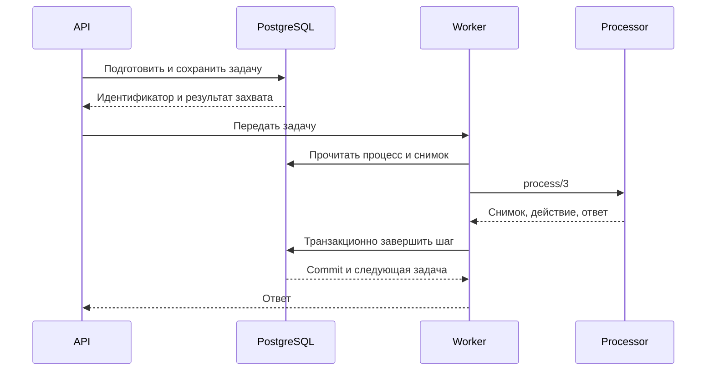

# PostgreSQL backend

Этот документ описывает хранение и координацию задач в generational-реализации Progressor. Пользовательский API и пример процессора приведены в [README](README.md). Точные SQL-запросы находятся в [prg_pg_backend.erl](src/storage/postgres/prg_pg_backend.erl); исполняемая схема — в [priv/migrations](priv/migrations).

## Схема и миграции

Для каждого namespace создаются пять таблиц с префиксом его имени. Например, namespace `counters` использует `counters_processes`, `counters_tasks`, `counters_schedule`, `counters_running` и `counters_generations`.

| Таблица | Назначение и ограничения |
|---|---|
| `processes` | Текущие атрибуты процесса: `status`, `previous_status`, `status_changed_at`, `aux_state`, `metadata`, `current_generation`, `detail`, `corrupted_by`. Первичный ключ — `process_id` |
| `tasks` | Записи задач и результаты: тип, аргументы, контекст, времена, статус, ответ, параметры retry и входное `generation`. `task_id` — `BIGSERIAL`; `idempotency_key` уникален в namespace |
| `schedule` | Ожидающие и заблокированные задачи; содержит данные, необходимые для запуска. Первичный ключ — `task_id` |
| `running` | Захваченная задача процесса. Первичный ключ — `process_id`, поэтому две записи на один процесс недопустимы |
| `generations` | Снимки: бинарный `payload`, timestamp, metadata и создавшая задача. Первичный ключ — `(process_id, generation)` |

`tasks` — история и результат, а `schedule`/`running` — оперативное состояние очереди. Во время выполнения не следует определять владельца задачи только по статусу в `tasks`: источником захвата служит `running`.

Идентификатор процесса и ключ идемпотентности имеют тип `VARCHAR(256)`. Номер поколения хранится как `INTEGER`. Времена — `TIMESTAMP WITH TIME ZONE`; API возвращает Unix-время в микросекундах. Снимки добавляются, но не обновляются обычным исполнением. Внешних ключей из `current_generation` и входного `generation` задач на снимки сейчас нет; ссылки снимков на процесс и породившую задачу защищены FK.

`epg_migrator` применяет миграции отдельно для realm namespace. Начальная миграция сразу создаёт generational-схему, включая статусы и индексы с уникальными для таблиц именами. Здесь нет этапов преобразования event sourcing или совместного использования его таблиц. Разворачивайте этот продукт в отдельной БД от event-sourcing версии; SQL enum-типы также общие для namespace внутри БД.

Автоматическое применение выполняется при старте namespace. `migration_enabled = false` позволяет отделить миграции от запуска приложения; тогда схема должна быть подготовлена заранее. Исполняемые миграции являются источником истины; исторический файл `priv/schemas/postgres-schema.sql` не предназначен для развёртывания этой реализации.

## Пулы соединений

В `storage.options` обязателен `pool`. Дополнительно можно указать:

- `front_pool` — операции публичного API;
- `scan_pool` — периодический поиск задач и zombie collection;
- `cache` — идентификатор БД для чтения через ETS-кэш.

При отсутствии отдельных пулов используется основной. Для одного namespace все пулы должны обращаться к одной и той же БД. Исполнение и проверка поколения перед `call` используют прямое чтение PostgreSQL.

## Приём и захват задач

### Инициализация

`prepare_init` в одной транзакции создаёт процесс со статусом `init` и запись задачи. При наличии свободного воркера задача помещается в `running`; иначе — в `schedule`.

До первого успешного завершения у процесса нет снимка и `current_generation`. Ошибка инициализации сохраняется частичным обновлением процесса без требования существующего поколения.

### Внешний вызов

API проверяет ключ идемпотентности, статус процесса и, если задан номер поколения, его существование. При отсутствии поколения возвращается `generation_not_found` до создания задачи. Эта предварительная проверка не является блокировкой процесса на всё время вызова.

`prepare_call` сохраняет задачу и блокирует ожидающий таймер. Если запись `running` свободна и воркер доступен, задача захватывается; иначе остаётся в `schedule`. На завершении текущей задачи backend ищет ожидающий вызов по минимальному `task_id`. Это порядок записей очереди, а не гарантия порядка конкурентных сетевых запросов.

Уникальность ключа идемпотентности обеспечивается в `tasks`. Проверка существующего результата и вставка нового запроса не являются одной операцией: одновременные первые запросы могут столкнуться с `unique_violation`. Ключ не обеспечивает атомарность внешних действий обработчика.

### Scanner и локальные таймеры

Scanner выбирает ожидающие вызовы и наступившие таймеры. Перенос из `schedule` в `running` выполняется транзакционно. Локальное сообщение таймера содержит идентификатор задачи, после чего worker вызывает `capture_task`.

`capture_task` проверяет `status = waiting`, использует блокировку строки и переносит задачу в `running`. Отменённую, заблокированную или уже забранную задачу нельзя запускать на основании одного локального сообщения. Конкуренция со scanner и другими узлами разрешается транзакциями и ограничениями PostgreSQL; конфликт БД не даёт разрешения выполнить второго обработчика.

Данные `generation` и `context` сохраняются при переносах между таблицами. Локальный таймер не является источником истины: потеря сообщения компенсируется поиском в БД. Возможны задержки и небольшое опережение срока; это не механизм точного real-time планирования.

## Исполнение и завершение

Обработчик выполняется вне SQL-транзакции. Worker читает выбранный снимок, вызывает `process/3` через sidecar и получает результат. Sidecar проверяет обязательный снимок до передачи успешного результата worker; исключение — немедленное удаление.

Успешный шаг обычно фиксирует одной транзакцией:

1. Частичное обновление атрибутов процесса и `current_generation`.
2. Вставку снимка с номером `current_generation + 1`.
3. Ответ, времена и входное поколение выполненной задачи.
4. Освобождение её записи в `running`.
5. Изменение таймера и, при наличии, захват следующего вызова.

| Операция backend | Изменение расписания |
|---|---|
| `complete_and_continue` | Отменить старый таймер, сохранить новый; приоритет отдать ожидающему вызову, если он есть |
| `complete_and_suspend` | Отменить таймер, сохранив возможность обработки ожидающих вызовов |
| `complete_and_unlock` | Сохранить прежний таймер и разблокировать его, когда нет продолжения из очереди вызовов |
| `complete_and_error` | Зафиксировать ошибку, отменить ожидающие вызовы и таймеры |

Ошибочная попытка `timeout`, для которой разрешён retry, завершается через `complete_and_continue` без нового снимка. Создаётся новая задача повторной попытки с сохранённым контекстом и увеличенным счётчиком. Повторный таймер работает с последним состоянием; это не повтор на автоматически закреплённой старой версии.

`remove_process` удаляет записи процесса во всех пяти таблицах транзакционно. После удаления его историю и результаты по ключам идемпотентности получить нельзя. Нет отдельного журнала удаления или встроенной политики retention поколений.

## Поколения и чтение

Номер в задаче означает выбранное входное состояние. Успешная задача на старом поколении создаёт следующий номер после текущего, а не отдельную ветвь снимков. Это не compare-and-swap и не защита от логической перезаписи результата более новой команды.

| Ситуация при чтении | Ответ |
|---|---|
| Процесса нет | `{error, <<"process not found">>}` |
| Явно выбранное поколение найдено | Процесс с этим снимком в `state` |
| Явно выбранное поколение отсутствует | `{error, {generation_not_found, N}}` |
| `latest`, первого снимка ещё нет и `current_generation` отсутствует | Процесс без ключа `state` |
| `latest`, снимков нет, но `current_generation` задан | `{error, {current_generation_not_found, N}}` |

`latest` выбирает максимальное сохранённое поколение. Проверка отсутствия снимков не является полной проверкой целостности всех ссылок и номеров.

Атрибуты процесса и снимок читаются отдельными SQL-запросами внутри транзакции. Backend не задаёт для этого чтения `REPEATABLE READ`: при обычном `READ COMMITTED` конкурентный commit может оказаться между запросами. Поэтому обход кэша не следует трактовать как атомарный снимок всей карты процесса на единственный момент времени.

`trace/1` читает задачи с присоединёнными снимками. `generation` — входная версия задачи, `state_generation` — созданная; `state_timestamp`, `state_metadata`, `state_payload` описывают результат. У ошибки, отменённой задачи или задачи без созданного снимка этих выходных полей нет. Это диагностика сохранённых данных, не распределённый tracing.

## Завершение узла и восстановление

При штатном завершении worker хранит continuation в своём состоянии. Для ещё не выполненной continuation типа `timeout`/`remove` `terminate/2` пытается вызвать `reschedule_task`: убрать запись из `running` и вернуть ту же задачу в `schedule` со статусом `waiting`. Это best effort: аварийное завершение, принудительное убийство или недоступность БД могут помешать возврату.

Zombie collector обрабатывает записи, чьё `running_time` старше `process_step_timeout` плюс защитный интервал 5 секунд. Проверка периодическая, поэтому обнаружение не происходит точно на границе этого срока. Транзакция:

- удаляет просроченную запись из `running`;
- помечает задачу ошибочной;
- отменяет ожидающие задачи и очищает расписание процесса;
- переводит процесс в `error` с `detail = <<"zombie detected">>` и `corrupted_by`.

Collector не доказывает, что прежний исполнитель прекратил внешнюю работу, и не выполняет её повторно автоматически. Восстановление через `repair` или `simple_repair` должно учитывать возможные уже выполненные эффекты. У внешних сервисов нужны собственные идемпотентные операции или fencing, если этого требует сценарий.

## Кэш логической репликации

[prg_pg_cache](src/storage/postgres/prg_pg_cache.erl) подписывается на изменения `processes` и `generations` и поддерживает локальные ETS-таблицы. Требуются `wal_level=logical`, доступные replication slots/wal senders и права на публикации и репликацию. PostgreSQL-права следует подготовить отдельно от обычных DML-прав приложения.

При промахе кэша чтение идёт в БД, включая случай, когда в ETS нет запрошенного поколения. При остановке репликации кэш очищается и пытается переподключиться. Это кэш изменений, а не полная предварительная загрузка всех процессов.

Репликация асинхронна; успешный commit не означает немедленного обновления ETS. Записи процесса и его снимков обновляются отдельно, поэтому кэш не предоставляет атомарное чтение всей карты. Для обхода используйте `options => #{use_cache => false}`.

Очистка ETS основана на неактивности процесса (по умолчанию 5 минут), а не на ограничении количества поколений. Активный процесс может накапливать много снимков в памяти; извлечение `latest` сейчас сортирует сохранённые поколения. При оценке нагрузки учитывайте размер payload, частоту шагов, память кэша и объём WAL.

## Практические границы гарантий

Атомарность относится к транзакциям Progressor в PostgreSQL. Она не распространяется на код обработчика, HTTP, сообщения и другие БД. При неопределённом результате commit или потере исполнителя нельзя обещать exactly-once внешнего эффекта.

Распределённая работа также предполагает общую доступную БД, согласованные настройки namespace и синхронизированные часы узлов. Встроенные метрики отражают длительности подготовки, обработки, завершения, сканирования и обращения к кэшу; глубину очередей и размер таблиц следует наблюдать отдельно.
